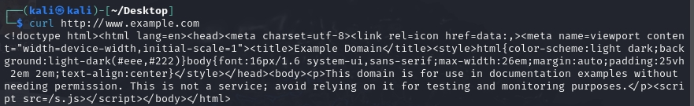
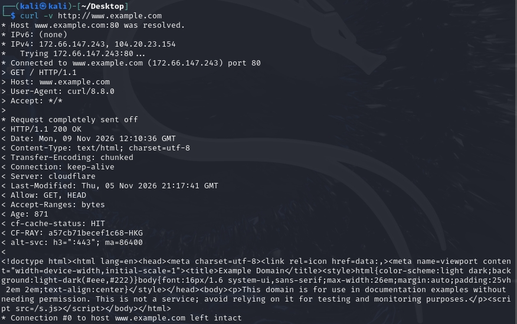
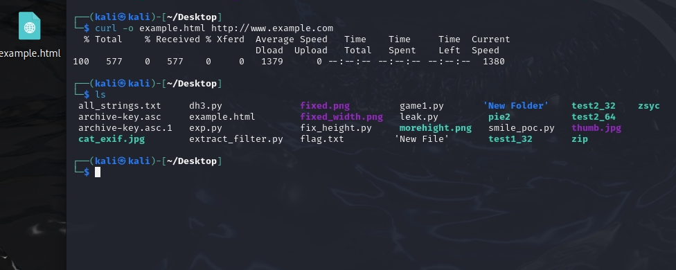

```yaml
---
layout: post
title: 网络安全作业：curl命令基础使用练习
date: 2026-11-09 12:00:00 +0800
categories: 网络安全 工具使用
---

## 一、工具简介
curl（Client URL）是一款功能强大的命令行数据传输工具，支持 HTTP、HTTPS、FTP、SFTP 等 20 多种协议，常用于 API 调试、网络问题排查、站点探测和自动化脚本编写，是渗透测试的基础工具之一。

## 二、常用命令实践
### 1. 基础 GET 请求
使用 curl 发起 GET 请求，获取目标网页的 HTML 源码。
```bash
curl [http://www.example.com](http://www.example.com)
```



### 2. 查看 HTTP 响应头
使用 `-I` 参数仅获取响应头部信息，快速查看站点状态码、服务器类型等信息。
```bash
curl -I [http://www.baidu.com](http://www.baidu.com)
```


### 3. 显示详细通信过程
使用 `-v`（verbose）参数显示完整的请求与响应过程，包含 TCP 连接、请求头、响应头等细节，便于排查网络问题。
```bash
curl -v [http://www.example.com](http://www.example.com)
```



### 4. 下载保存文件
使用 `-o` 参数将响应内容保存到本地文件，实现命令行下载。
```bash
curl -o example.html [http://www.example.com](http://www.example.com)
```



## 三、常用参数总结
| 参数 | 功能说明 |
|------|----------|
| `-I` | 仅获取 HTTP 响应头 |
| `-v` | 显示详细的请求与响应过程 |
| `-o 文件名` | 将响应内容保存为本地文件 |
| `-X 方法` | 指定请求方式，如 GET/POST/PUT |
| `-d 参数` | 携带 POST 请求的表单数据 |
```

---

